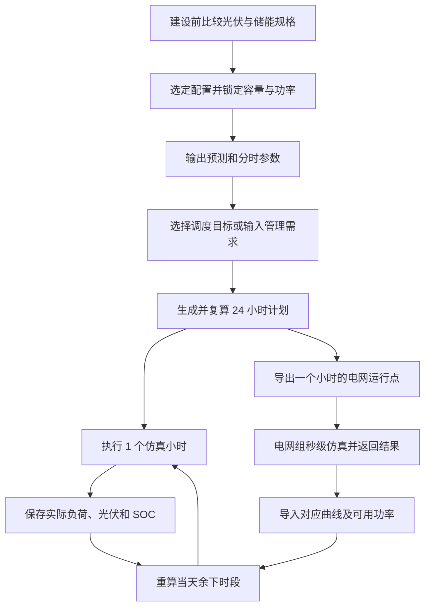

# EnergyOps 园区能源调度 Demo

EnergyOps 从零碳校园建设前的**光储配置模拟**切入，最终面向园区管理人员的**日常能源调度**。规划阶段比较候选设备的运行表现。设备投运后，产品将读取设备规格、可用功率和并网约束，沿用日前计划与日内反馈流程。

| 版本 | 体验范围 |
| --- | --- |
| GitHub `main` 的静态代码 | 归档光伏与负荷预测回放、碳因子及设备参数、三类小时调度方案、预设故障恢复与报告 |
| 团队本地完整 Demo | 在上述流程上加入建设前配置比较、装机联动、逐小时反馈、DeepSeek 单方案入口和电网运行点交接 |

[已发布演示站点](https://energyops-campus-demo.w-julien888.chatgpt.site/) · [项目故事视频](outputs/video/energyops_demo.mp4) · [中文字幕](outputs/video/energyops_demo.zh-CN.srt)

## 完整 Demo 怎么运行



1. **建设前配置比较。** 在相同的 44 个回放日、分时电价、碳因子和 5% 费用增幅上限下，比较弃光、购电费、购电碳排和峰值购电。选定后，以固定装机和储能规格进入调度。
2. **准备运行输入。** 归档 GRU 光伏与 DormPatch-96 负荷按月、日、时刻配对。每天 96 个 15 分钟功率点按每四点均值转换成 24 个小时输入，以保持电量一致。负荷是按比例放大的跨年回放，进入调度后为逐小时变化的固定园区总负荷。默认使用广东 2025 年 S1 中碳典型日因子和演示分时电价。预测和参数分别确认输出，变更输入后重新输出。
3. **生成日前计划。** 常规入口提供经济优先、低碳优先和成本约束低碳。自然语言入口将「优先减碳，但购电费用最多增加 3%」之类的需求交给 DeepSeek，提取目标和 0–30% 的相对费用增幅上限，然后由确定性调度引擎生成并展示一套方案。自然语言入口需要配置本地 API。
4. **逐小时反馈。** 每次推进一个仿真小时，记录模拟负荷、光伏和实际 SOC，沿用所选目标和设备边界更新余下时段。原始日前计划和已执行记录留在当前页面会话中。
5. **电网交接。** 从已生成的日前计划导出指定小时的运行点，包括设备规格、功率和 SOC。电网组可返回秒级电压、频率、母线功率或电流曲线。导入会核对设备规格、计划编号、日期、版本和小时。若结果包含后续储能可用功率，在仿真推进到该小时结束后可应用该上限重算。正式稳定性结果与校园接入限额待电网组提供。

## 默认光储配置与选取依据

| 参数 | 完整 Demo 默认值 | 依据 |
| --- | ---: | --- |
| 光伏装机 | **6 MWp** | 校园光伏布置图标明屋顶规划容量 10.3506 MWp，6 MWp 约占 58%，折合约 9,231 块 650 Wp 组件 |
| 储能功率 | **250 kW** | 6 MWp 场景下，44 个样本日的最大小时光伏富余约 230 kW |
| 储能容量 | **600 kWh** | SOC 15%–90% 对应 450 kWh 的可用能量窗，样本中最大单日光伏富余约 439 kWh |
| 对照场景 | **20.0772 MWp** | 校园图纸中屋顶、墙面与停车场的全建总装机，用于禁止馈电时的富余压力测试 |

页面也可选择 64 kW / 320 kWh 和 300 kW / 800 kWh。6 MWp 配 250 kW / 600 kWh 在 44 日日前方案中无弃光，逐小时反馈回放累计弃光约 206 kWh。300 kW / 800 kWh 的回放累计约 183 kWh。设备工程定容还需要同期校园数据、馈电政策、投资、寿命及接入条件。放电功率另需结合削峰目标和持续时间校核，Demo 使用同一个充放电功率上限。

改变装机时，Demo 用「候选装机 ÷ 20.0772 MWp」逐点缩放全建光伏预测。6 MWp 取全建曲线的约 29.9%，保留日内曲线形状。设计阶段若调整屋顶范围、朝向、倾角、遮挡或逆变器配比，需要按实际阵列重新计算。

## 调度引擎如何决策

- **边界。** 优化在园区聚合层进行。光伏先服务园区负荷，余量用于电池充电，剩余计为弃光。参考场景允许电网充电和购电，禁止馈电。楼栋间电量分配与配电网潮流由其他模型处理。
- **电池动作。** 富余光伏优先充电。没有富余时，引擎根据电价与购电碳因子的加权分数安排充放电，受功率、SOC、95% 单程效率和日末恢复目标约束，充放电互斥。调度页可查看每小时动作、充电来源、SOC 变化和功率上限。
- **目标和复算。** 浏览器引擎扫描 81 组权重候选，按购电费用、逐时购电量乘碳因子所得的排放，以及相对经济基准的费用上限择优。另行复算功率平衡、能量递推、SOC、功率与成本。成本和碳结果适用于演示输入，算法为启发式候选扫描。
- **仿真范围。** Demo 输出供方案比较与团队交接，全部运行在仿真模式。购电碳排是校园碳中和行动的一项量化输入。秒级响应及判据来自电网组的独立模型。

## 本地启动

**从 GitHub 克隆静态 Demo**，在仓库根目录运行：

```bash
python3 -m http.server 8765 --bind 127.0.0.1 --directory dist
```

浏览器访问 [http://127.0.0.1:8765/](http://127.0.0.1:8765/)。在「负荷与光伏预测」页输出预测，再到「碳因子与设备参数」页输出参数，进入「日前调度方案」。

**从团队完整工作区启动 DeepSeek 入口**，使用 Python 3.11 或更新版本并安装工作区依赖，在工作区根目录运行：

```bash
python3.11 "04_代码/scripts/run_stage_f_dashboard.py" \
  --dist-dir "03_Demo和视频展示/energyops-demo/dist" --port 8766
```

在服务端环境中设置 `DEEPSEEK_API_KEY`，也可使用服务支持的本地 secrets 文件。浏览器访问 [http://127.0.0.1:8766/](http://127.0.0.1:8766/)。常规调度入口可在无密钥时使用。

## 代码、检查与团队交接

| 路径 | 用途 |
| --- | --- |
| [`dist/engine.js`](dist/engine.js) | 浏览器调度与独立复算 |
| [`dist/business-ui.js`](dist/business-ui.js) | Demo 的业务页面 |
| [`dist/joint-forecast-ui.js`](dist/joint-forecast-ui.js) | 联合预测回放与调度输入适配 |
| [`dist/meeting-support.js`](dist/meeting-support.js) | 输出快照、对照与电网结果展示 |
| [`docs/STABILITY_RESULT_FORMAT.md`](docs/STABILITY_RESULT_FORMAT.md) | GitHub 静态版的电网模型结果格式 |
| [`video/README.md`](video/README.md) | 视频流水线与生成方式 |

Node.js 18 或更新版本可运行 `npm test` 和 `npm run check`。修改页面素材后运行 `npm run prepare:site` 更新缓存版本。协作范围见[团队协作说明](docs/CONTRIBUTING.md)和[模型接入建议](docs/MODEL_INTEGRATION.md)。

GitHub 用于代码与文档协作。公开站点由 Sites 托管，需要独立发布。
